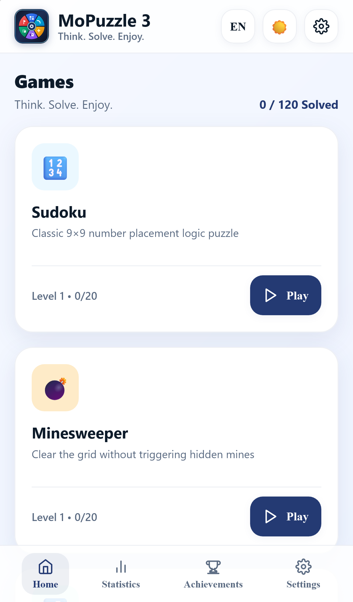
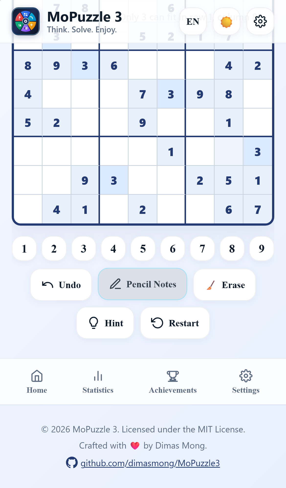
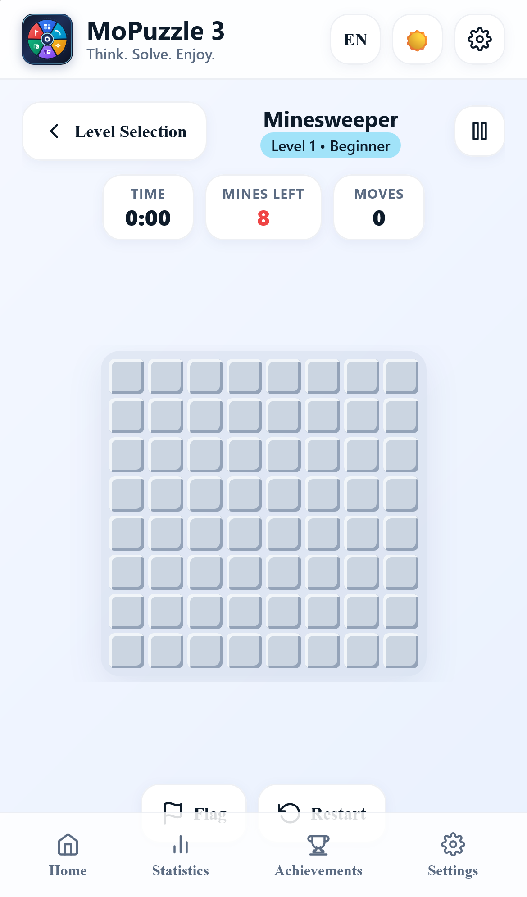
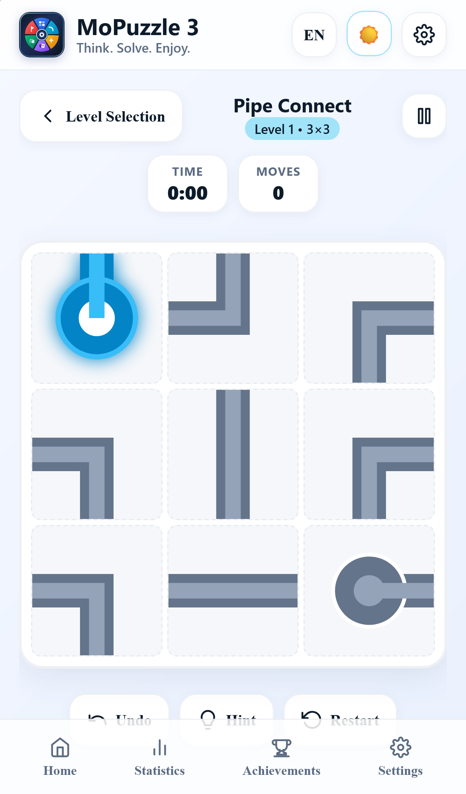
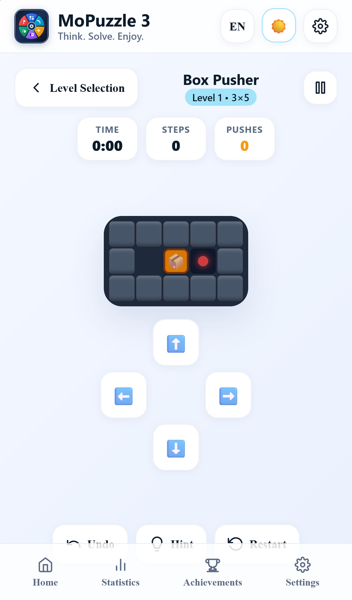
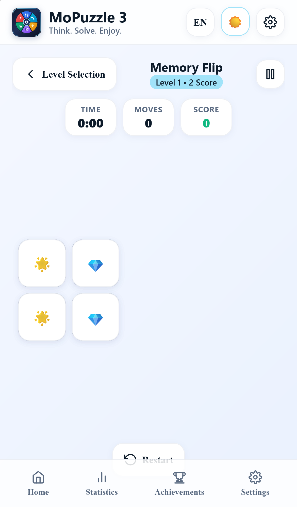
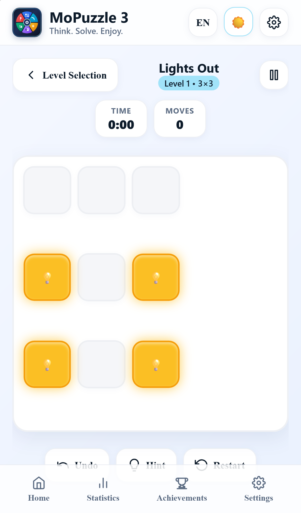
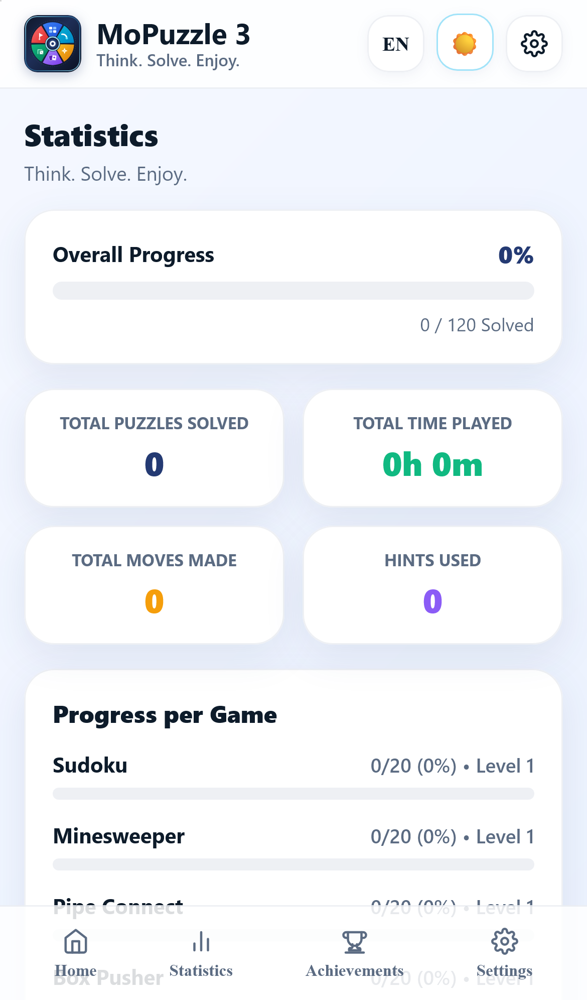
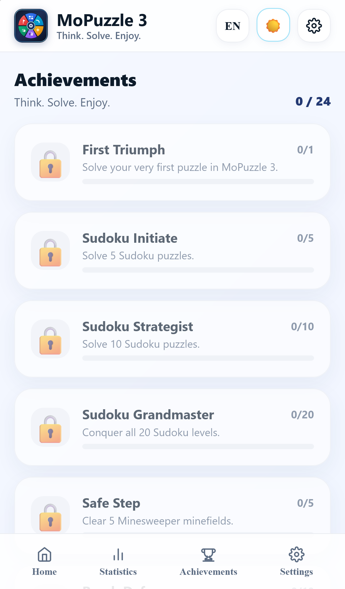

# MoPuzzle 3

<p align="center">
  
</p>

[](LICENSE)
[](https://github.com/dimasmong/MoPuzzle3/actions)
[](https://www.typescriptlang.org/)
[](https://vitejs.dev/)
[](https://playwright.dev/)
[](https://mopuzzle3.vercel.app)

> **Think. Solve. Enjoy.**
> Six complete, mathematically verified, client-side browser puzzle games in one unified collection.

**MoPuzzle 3** is the third installment in the acclaimed MoPuzzle series. Built from scratch with strict TypeScript, HTML5 Canvas/DOM, Web Audio, and Vite, it faithfully replicates the design language, color tokens, and responsive layout of the original **MoPuzzle 1**, while delivering six original, fully playable puzzle engines with **120 verified solvable levels** (20 per game).

🌐 **Live Production Game**: [https://mopuzzle3.vercel.app](https://mopuzzle3.vercel.app)

---

## 📸 Screenshots

| Home Page | Sudoku | Minesweeper |
|:---:|:---:|:---:|
|  |  |  |

| Pipe Connect | Box Pusher | Memory Flip |
|:---:|:---:|:---:|
|  |  |  |

| Lights Out | Statistics | Achievements |
|:---:|:---:|:---:|
|  |  |  |

---

## 🎮 The Six Games

### 1. Sudoku (9×9)
- **Rules**: Fill the 9×9 grid so every row, column, and 3×3 region contains digits 1 through 9 exactly once without repeats.
- **Features**: Number keypad, keyboard 1–9 input, arrow navigation, Pencil Notes mode, Erase, Undo/Redo, Mistake highlighting, and Solver-backed Hints.
- **Difficulty**: Easy, Medium, Hard, and Expert.
- **Levels**: 20 precomputed, verified levels with guaranteed unique solutions.

### 2. Minesweeper
- **Rules**: Uncover all safe cells without detonating any hidden mines. Numerical clues indicate adjacent mine counts.
- **Features**: First-click safety (never detonate on opening click), automated recursive flood fill, flag mode, right-click desktop flagging, and chord reveals on satisfied cells.
- **Difficulty**: Beginner (8×8), Intermediate (10×10 to 12×12), and Advanced (13×13 to 14×14).
- **Levels**: 20 progressive challenge boards.

### 3. Pipe Connect
- **Rules**: Rotate pipe segments in 90-degree increments to channel water from the source reservoir to all target destinations without leaks.
- **Pipe Types**: Straight, Corner (bend), T-Junction, Cross, End Cap, Source, and Destination.
- **Features**: Animated fluid flow, connection previews, rotation counter, Undo/Redo, and Hints.
- **Levels**: 20 mathematically verified solvable networks (3×3 to 5×5).

### 4. Box Pusher (Sokoban)
- **Rules**: Guide the worker robot to push all crates onto their designated goal tiles. Crates cannot be pulled and cannot pass through walls.
- **Features**: Arrow keys / WASD controls, on-screen touch D-Pad for mobile, push counter, step counter, Undo history, and BFS state-space hint solver.
- **Levels**: 20 curated and verified solvable layouts with deadlock awareness.

### 5. Memory Flip
- **Rules**: Flip pairs of cards to reveal hidden symbols. Matched pairs remain open; non-matching pairs flip back after a brief delay.
- **Features**: 3D card rotation animations, original symbols, combo multiplier, move counter, score, and star rating.
- **Levels**: 20 challenges progressing from 2×2 up to 4×5.

### 6. Lights Out
- **Rules**: Pressing any tile toggles itself and its orthogonal neighbors. The objective is to turn off all lights.
- **Features**: GF(2) linear algebra solver using Gaussian elimination, hint engine, smooth toggle animations, and Undo/Redo.
- **Levels**: 20 verified solvable levels across 3×3, 4×4, and 5×5 grids.

---

## 🎨 UI/UX Design Direction

MoPuzzle 3 strictly inherits the visual design language of **MoPuzzle 1**:
- **Light Theme**:
  - Page Background: `#F5F8FF` (with subtle linear gradient `#E8F0FE`)
  - Primary Color: `#243A73`
  - Accent Color: `#A1E3F9`
  - Cards: `#FFFFFF`
  - Text: Deep navy (`#0D1B2A`)
- **Dark Theme**:
  - Page Background: `#101827` (with gradient `#162033`)
  - Surface: `#1E2A3D`
  - Accent Color: `#A1E3F9`
  - Text: Soft white (`#F8FAFC`)
- **Responsive Layout**:
  - Desktop: 3-column × 2-row balanced game card grid on wide screens.
  - Tablet: 2-column adaptive layout.
  - Mobile: Clean single-column view with 44px+ touch targets and sticky bottom navigation.

---

## ⚙️ Architecture & Shared Systems

- **Progression Engine**: Explicit lifecycle state machine:
  $$\text{IDLE} \rightarrow \text{PLAYING} \rightarrow \text{COMPLETING} \rightarrow \text{COMPLETED} \rightarrow \text{LOADING\_NEXT} \rightarrow \text{PLAYING}$$
  Eliminates double next-level advances, cleans up prior scene listeners, and displays campaign completion at Level 20.
- **Persistence & Storage**: Versioned schema (`mopuzzle3_save_data`) with corruption recovery and independent progress tracking for all 6 games.
- **Synthesized Audio Engine**: Zero-asset procedural Web Audio API tones for interactions and optional calm ambient background music.
- **Localization**: Native support for **English** (`en`) and **Indonesian** (`id`).
- **Achievements**: 24 trackable achievements with real-time progression.
- **Progressive Web App (PWA)**: Standalone installation support, web manifest, and offline service worker caching.

---

## 🚀 Local Development

### Prerequisites
- Node.js 18+ (tested on Node v24)
- npm 9+

### Setup
```bash
# Clone the repository
git clone https://github.com/dimasmong/MoPuzzle3.git
cd MoPuzzle3

# Install dependencies
npm install

# Start Vite development server
npm run dev
```

### Production Build
```bash
# Typecheck and build production bundle into /dist
npm run build

# Preview production build locally
npm run preview
```

### Automated Testing
```bash
# Run Vitest unit & level audit tests
npm run test

# Run Playwright end-to-end tests
npm run test:e2e
```

---

## 📄 License & Attribution

- **License**: [MIT License](LICENSE) © 2026 Dimas Mong.
- **Author**: Crafted with ❤️ by [Dimas Mong](https://github.com/dimasmong).
- **GitHub**: [https://github.com/dimasmong/MoPuzzle3](https://github.com/dimasmong/MoPuzzle3)
